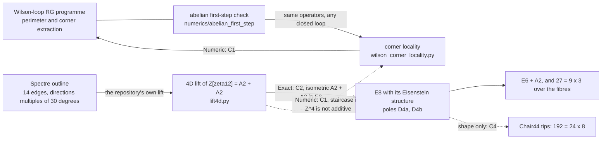

# Geometry bridge: what the tiling, E8 and Hopf-fibre work does and does not say about the Wilson-loop programme

This note connects the Wilson-loop programme of this repository to a second body of work in the fork
[`brentharts/spectre-monotile-py`](https://github.com/brentharts/spectre-monotile-py): finite computations on the Spectre monotile,
the Chair44 solid, the E8 lattice and its Hopf fibres. It says what is connected, how, and how firmly. It is a map, not a result.

Like the rest of this repository it was written with LLM assistance and has not been independently reviewed. Every statement below is labelled:

- **Exact**: a finite enumeration or an identity, checked by a test that can fail.
- **Numeric**: a computed number with a stated tolerance, tolerances chosen after seeing the data where noted.
- **Hypothesis**: not shown. Included only so that it is not mistaken for a finding.

## 0. Read this first

1. **One link is real and numerical.** The abelian first-step operators in [`numerics/abelian_first_step`](numerics/abelian_first_step/README.md)
   can be applied to loops other than squares. Doing so shows that, at the one placement the published square fits use (loop corner at a block centre),
   the perimeter-plus-corner form `E_f = αP + b c` holds, with one constant per corner, when every feature of the loop is at least two blocks wide.
   It fails for features one block wide and for dense corners. **The placement matters more than the corner term**: moving a loop against the blocks
   changes `E_f` by 0.28 to 0.91, and the placement used is the lowest-energy one (section 3, C1, and [`numerics/corner_locality`](numerics/corner_locality/README.md)).
2. **One link is structural and exact.** The 4D lattice the Spectre lift uses is a red hexagonal lattice plus a green one, and that sum embeds in E8 so that every
   Spectre edge is a root (C2). It gives the Spectre outline a small, fixed set of corner types in 4D.
3. **The two do not yet meet.** The hypercubic action used in the abelian check sees every turn between different axes as 90 degrees, so it cannot tell the
   hexagonal corner types apart. Doing so needs an action and a block-averaging map on the hexagonal lattice, which do not exist (section 5, P1).
4. **Nothing here supports or refutes a step of the programme.** No estimate, bound, domain condition or proof in [`STATUS_MAP.md`](STATUS_MAP.md) is checked or used.
   The E8, Hopf-fibre and Chair44 results are independent of the Bałaban construction and were not derived from it.

## 1. The map

Solid arrows are computed; dotted arrows are comparisons that mostly fail or are partial.

## 2. Where the pieces live, and under what terms

| Piece | Repository | Terms | How it is used here |
|---|---|---|---|
| Wilson-loop programme, abelian check | this repository | CC0 | operators imported, not copied |
| Spectre / Chair44 / E8 / Hopf models, with tests and figures | [`spectre-monotile-py`](https://github.com/brentharts/spectre-monotile-py), directory `models/` | the fork of an upstream repository without a licence file in this checkout; models written in the fork | **linked, not copied** |
| Write-ups | `QUANTUM_GRAVITY.md`, `TILE_E8_BRIDGE.md` in that repository | same | linked |
| E8, 600-cell, Sadoc-Mosseri survey | `Quantum_Gravity_Lab` | CC0 | cross-checked, nothing copied |
| E8 > E6 x SU(3) and Lisi bridge | `chirality-standard-model` | all rights reserved, private review | read only, pointer only |

Nothing in this note copies code or text from a repository whose terms forbid it.

## 3. Results that touch the programme

### C1. Is the corner term local? (Numeric)

Module [`models/wilson_corner_locality.py`](https://github.com/brentharts/spectre-monotile-py/blob/main/models/wilson_corner_locality.py), 9 checks, about 40 s, set `WILSON_RG_DIR`
to a clone of this repository. It uses this repository's `Lat`, `curl_operator`, `div_operator`, `averaging_operator`, `extract_blocks`, `bloch`, `null_space` with a batched Bloch sum that accepts any closed loop on the
4-torus (K = 6, L = 3, `landau` gauge). `P` is the number of links and `c` the number of corners.

- Squares of side 3, 6, 9 give 1.85575, 3.92455, 5.96995, against the published K = 10 values 1.855780, 3.924427, 5.970860. The energy is invariant to 1e-9 under permuting axes,
  reversing the loop and translating by L.
- For seven loops with every feature at least 2L = 6 units wide (squares, rectangles, an L-shape, two skew loops that span three directions), `E_f = αP + bc` fits with
  `α = 0.1709` per link and `b = -0.0444` per corner (`4b = -0.178`; the published square fit is `α = 0.1707`, `β = -0.17` to `-0.18`). Each loop left out is predicted to 0.006 or better. **At that placement, one constant per corner works in this
  analogue when corners and edges are a few blocks apart.**
- Thin rectangles and L-shapes with a 3-unit feature sit 0.016 to 0.039 below that fit, at that placement. In a width scan (length 12, widths 3, 6, 9, 12; K = 6 and 8) the deviation is
  -0.037 at width 3 and within 0.004 from width 6 on, so the range of the failure is the block size L.
- **Placement.** Over all 81 positions of a loop modulo the block period (3 in each of four directions), `E_f` has a spread of 0.28 to 0.91 per loop, 15 to 25 percent of `E_f` and more than the whole corner
  term (`|4b| = 0.18`); the published placement is the minimum for every loop tried. Averaged over the 81 positions the fit is `α = 0.1906`, `b = -0.0618` (`4b = -0.247`), still roughly additive
  (leave-one-out 0.023), and the width-3 deficit becomes a small excess (+0.02). So the thin-loop deficit is a property of the aligned placement, and the published `α`, `β` are the values for the
  most favourable placement. I have not compared this with how the programme's blocks sit against a loop.
- The Spectre outline lifted to Z^4 (C2) is not additive: its `E_f` is 0.30 to 0.66 *above* the prediction at every dilation and in both orderings of a diagonal step. A diagonal becomes a
  lattice-scale zigzag whose corners are one link apart, so the corner terms interact. Two orderings of the same diagonal give different loops (13 versus 17 corners) with `E_f` 2.797 versus 2.649.

### C2. The Spectre outline in 4D, and in E8 (Exact)

Module [`models/spectre_in_e8.py`](https://github.com/brentharts/spectre-monotile-py/blob/main/models/spectre_in_e8.py), 12 checks.

- The Spectre's own 4D lift ([`lift4d.py`](https://github.com/brentharts/spectre-monotile-py/blob/main/lift4d.py) in that repository, the Cheritat-Ma lift as cited there) writes every edge, a unit vector at a multiple of 30 degrees, as an integer step of a red
  hexagonal lattice (even multiples) or a green one (odd multiples). The lift lattice is `Z[zeta_12]`, a red A2 plus a green A2.
- E8 has an order-3 rotation `R_w` that makes it a module over the Eisenstein integers. With two Hermitian-orthogonal roots, the lift lattice embeds in E8 **isometrically**: all 518
  vertices of a 71-tile patch embed injectively, **every edge becomes a root**, and every tile outline becomes a closed walk of 14 roots (8 red, 6 green). The inner product of consecutive edge roots is
  2 cos(turn) for equal colours and 0 for a red-green pair.
- Corner types of the lifted outline, the same for all 71 tiles: 7 turns of 60 degrees, 6 turns of 90 degrees, 1 straight pass. This is the "small set of corner types" the programme's corner
  extraction would have to handle for a Spectre-shaped contour. They are visible in the hexagonal lattice and **invisible to the hypercubic action** of C1.
- The Spectre inflation does not extend to E8: its 4D block has characteristic polynomial `x^4 - 8x^2 + 1` with `λ = (√3 + √5)/√2`, so it has eigenvalues of modulus other than 1. The field generated by
  `λ` contains `√15 = √3 √5` but not `√3`, `√5` or the golden ratio, so the Spectre and the icosian E8 use different number fields.

### C3. E8, E6 and the Hopf fibres (Exact, background)

Modules [`hopf_shells.py`](https://github.com/brentharts/spectre-monotile-py/blob/main/models/hopf_shells.py), [`icosian_e8.py`](https://github.com/brentharts/spectre-monotile-py/blob/main/models/icosian_e8.py),
[`e8_shells.py`](https://github.com/brentharts/spectre-monotile-py/blob/main/models/e8_shells.py), [`fibre_window.py`](https://github.com/brentharts/spectre-monotile-py/blob/main/models/fibre_window.py),
[`voronoi_window.py`](https://github.com/brentharts/spectre-monotile-py/blob/main/models/voronoi_window.py), [`e6_fibres.py`](https://github.com/brentharts/spectre-monotile-py/blob/main/models/e6_fibres.py).

- The 240 roots of E8, as pairs of Hurwitz quaternions, split into 10 Hopf fibres of 24 (each a 24-cell); the 120 unit icosians are the 600-cell and are five disjoint 24-cells. The icosian and
  Hurwitz constructions give the same fibred root system. The shells have `240 σ_3(n)` vectors.
- A ball window in the icosian perpendicular space never splits a fibre; the same ball in the Coxeter-plane splitting does. The Voronoi-cell window (a nearly spherical polytope, inradius 0.909, circumradius 0.973) keeps every
  fibre whole because it is invariant under the fibre group of order 24.
- E8 minus the two pole fibres is 8 fibres, cut 8 + 8 + 8 by the three triality blocks of the `D4 x D4` picture. The order-3 fibre rotation cycles those blocks. An A2 in a pole fibre has an orthogonal
  E6 (72 roots), and the remaining 162 roots are six copies of the 27, each meeting 9 fibres in 3 roots.

None of this bears on the Wilson-loop estimates. It is listed because C2 uses the same E8 structure, and because the programme is stated for a compact simple gauge group, which in principle includes E6 and E8; no
computation here uses them as gauge groups.

### C4. The Chair44 count 192 (Exact, negative)

[`models/chair_e8_192.py`](https://github.com/brentharts/spectre-monotile-py/blob/main/models/chair_e8_192.py). The Chair44 has 192 pyramid tips (24 panels of 8; the 24 signed heights occur 8 times each),
and E8 minus its poles has 192 roots. The shapes agree (3 x 8 x 8), the structures do not: negation fixes every E8 block while the bump-dent flip exchanges two Chair classes, and the Chair solid has no non-trivial cube
symmetry where E8 has a free action of order 24. So `192 = 24 x 8` remains a coincidence of counts.

## 4. What is not connected

- **No bound or proof.** The abelian analogue has no commutators, no large-field regions and no running coupling; the cutoff prescription, gauge-fixing and small/large-field split of the programme are not used.
- **No non-abelian statement.** Everything in C1 is U(1).
- **No continuum or mass-gap statement.** The numerics are at one blocking factor (L = 3, not L > 11) and one torus size, and depend on how the loop sits against the blocks.
- **No tile in the programme.** The programme works with square loops on a hypercubic lattice. Spectre-shaped contours are not part of it; C2 only says what such a contour would look like in 4D.
- **No physical claim.** In particular nothing here relates E8 or the tilings to Yang-Mills dynamics.

## 5. Open problems that would make the connection real

Ordered by cost.

- **P2 (done, Numeric).** Range of the locality failure: about L at the aligned placement (`numerics/corner_locality/width_scan.py`). Not yet run for `L` other than 3.
- **P3 (done, Numeric).** Placement dependence: large, see C1 (`numerics/corner_locality/offset_average.py`). Open: which placement, if any, corresponds to the programme's construction, and a run at `L` other than 3.
- **P1 (large).** A U(1) action on the `A2 + A2` lattice (triangular plaquettes in each plane, rectangles between planes) and a block-averaging map on hexagonal blocks, so that 60 and 120 degree corners can be told from 90 degree ones. This is the test C1 could not do.
- **P5.** Decide whether a contour with 30-degree-multiple edges, whose hexagonal corners are 60 or 120 degrees, is admissible for the programme's corner extraction, and what its corner renormalisation `z_c` should depend on.
- **P4 (out of scope here).** The same locality question for SU(2).

## 6. Reproduce

    # in a clone of spectre-monotile-py, with numpy, scipy, sympy, matplotlib
    export WILSON_RG_DIR=/path/to/4D_Wilson_Loop_RG
    python3 models/wilson_corner_locality.py --tests-only       # 9 checks, about 40 s
    python3 models/spectre_in_e8.py --tests-only                # 12 checks
    python3 models/chair_e8_192.py --tests-only                 # 11 checks
    python3 models/e6_fibres.py --tests-only                    # 25 checks
    python3 models/voronoi_window.py --tests-only               # 10 checks, about 35 s
    python3 models/fibre_window.py --tests-only                 # 11 checks

Longer write-ups with every figure and the mutation checks: [`TILE_E8_BRIDGE.md`](https://github.com/brentharts/spectre-monotile-py/blob/main/TILE_E8_BRIDGE.md) and
[`QUANTUM_GRAVITY.md`](https://github.com/brentharts/spectre-monotile-py/blob/main/QUANTUM_GRAVITY.md).
